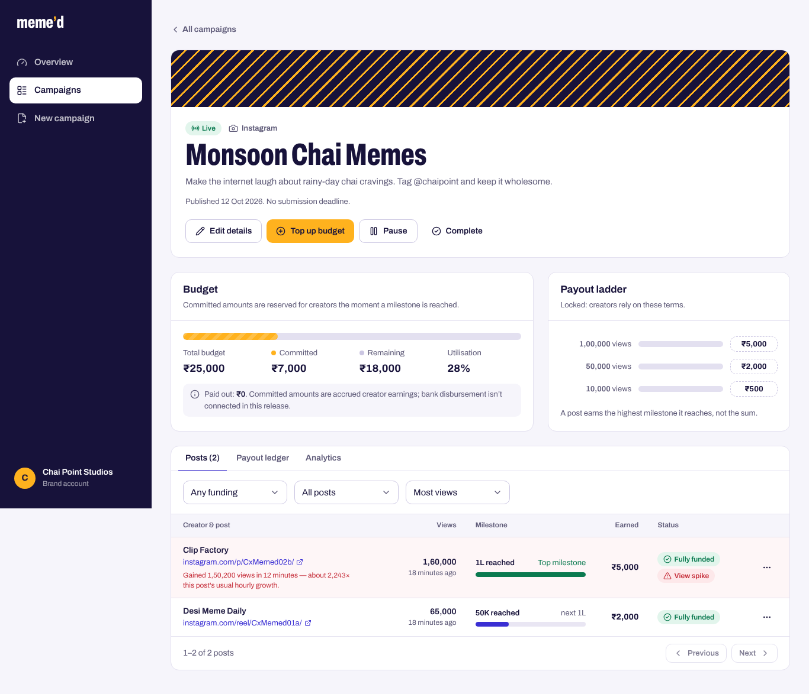
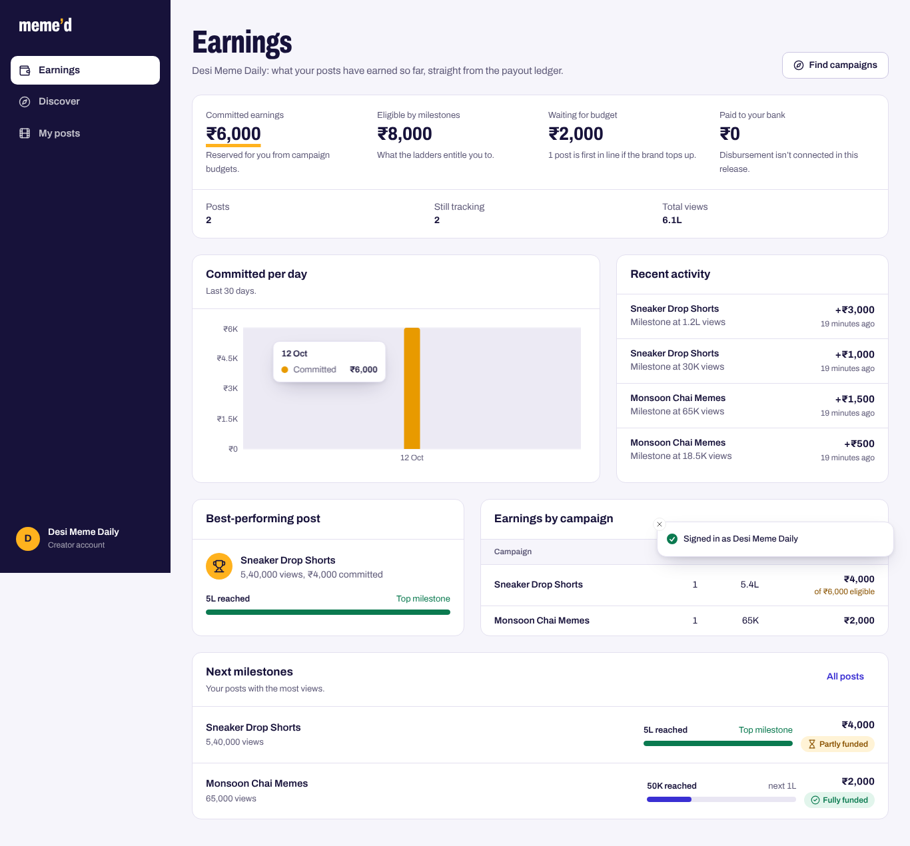
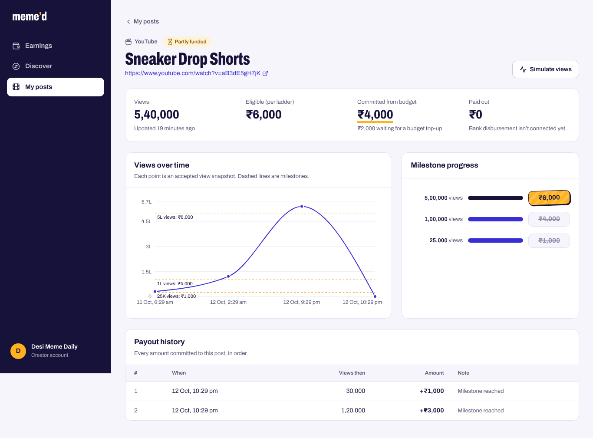

# Meme’d — Campaign Payout Tracker

Meme’d connects brands with meme pages, clip accounts and creators. A brand funds a campaign with a fixed budget and a **ladder of view milestones** (10K views → ₹500, 50K → ₹2,000, 1L → ₹5,000). Creators submit their Instagram or YouTube posts, views are tracked, and each post earns the payout of the **highest milestone it reaches** — never the sum, and never more than the campaign’s budget, even when many view updates arrive at once.


| Brand: campaign detail | Creator: earnings |
|---|---|
|  |  |
| **Brand: analytics with integrity check** | **Creator: post detail** |
|  |  |

These are real screenshots of the app running locally with the seed data (`npm run seed`); more are in [`docs/screenshots/`](docs/screenshots). There is no public live deployment (see [Deployment status](#21-aws-deployment)).

---

## Contents

1. [Key features](#3-key-features)
2. [Tech stack](#4-technology-stack) · [Architecture](#5-architecture-overview) · [Folder structure](#6-project-folder-structure)
3. [Run it locally](#7-prerequisites) · [Environment variables](#9-environment-variables) · [MongoDB Atlas](#10-mongodb-atlas-setup) · [Redis](#11-redis-setup) · [Docker Compose](#12-docker-compose)
4. [API reference](#13-api-endpoints)
5. [Auth design](#14-authentication-and-authorization) · [Payout rules](#15-payout-calculation) · [Budget cap & concurrency](#16-budget-cap-and-concurrency) · [Partial-budget policy](#17-partial-budget-policy) · [Ledger & idempotency](#18-ledger-and-idempotency) · [Anomaly detection](#19-anomaly-detection)
6. [Tests](#20-tests) · [AWS deployment](#21-aws-deployment) · [Assumptions & limitations](#23-assumptions-and-known-limitations) · [Scaling to 10,000 creators](#24-scaling-to-10000-creators) · [Security](#25-security-considerations)

---

## 3. Key features

**Brands**
- Four-step campaign wizard (basics → payout ladder → budget & dates → review) with a live ladder preview; save as draft or publish.
- Budget, milestones and platform lock on publish. Budgets can only grow (top-ups), and a top-up immediately back-fills under-funded posts, oldest first.
- Campaign list with status/platform filters, search and pagination; status machine Draft → Live ⇄ Paused → Completed.
- Campaign detail: budget meter (total / committed / remaining / utilisation / paid-out), posts table (views, milestone progress, earned vs eligible, funding status, spike flags), append-only payout ledger, analytics (daily commitments, milestone distribution, funding breakdown) and a **books-balance integrity check**.
- Review tools: mark view spikes as reviewed, reject off-brief posts that haven’t earned yet.

**Creators**
- Discover live campaigns with budget left: search, platform, minimum payout, sort; Redis-cached.
- Submit a post link (validated and canonicalised, never fetched); duplicates and posts already claimed by someone else are rejected.
- Earnings dashboard: committed earnings, eligible-by-ladder, waiting-for-budget, paid-out (₹0, honestly labelled), daily chart, earnings by campaign, best post, recent activity, next milestones.
- Post detail: views-over-time chart with milestone lines, ladder progress, per-post payout history.

**Platform**
- Transactional payout engine: conditional atomic budget reservation inside retried MongoDB transactions, optimistic locks, unique ledger keys, idempotency keys, deterministic reconciliation job.
- Configurable view-spike heuristic that flags but never blocks.
- Redis discovery cache with O(1) invalidation, Redis-backed distributed rate limiting, graceful degradation when Redis is down.
- Cookie-based auth with rotating refresh tokens, reuse detection, CSRF protection, account lockout.
- Dockerfiles, Compose, CI, AWS (ECS Fargate + ALB + Atlas + ElastiCache) configuration.

## 4. Technology stack

| Layer | Choices |
|---|---|
| Frontend | Next.js 16 (App Router, standalone output), React 19, TypeScript (strict), Tailwind CSS 4, shadcn/ui-style components on Radix primitives, Lucide, React Hook Form + Zod 4, TanStack Query 5, Recharts 3, Sonner toasts, Archivo variable font (self-hosted) |
| Backend | Node.js 22, Express 5, TypeScript (strict), Mongoose 8, Zod 4, JWT (`jsonwebtoken`), Argon2id, Pino, Helmet, CORS, ioredis |
| Data | MongoDB Atlas (replica set, transactions), Redis (cache, rate limits, job lock) |
| Tests | Jest 30, ts-jest, Supertest, mongodb-memory-server (replica set) |
| Infra | Docker multi-stage images, Docker Compose, GitHub Actions, AWS ECS Fargate, ECR, ALB + ACM, Secrets Manager, CloudWatch, ElastiCache |

**Documented deviations.** shadcn/ui is a copy-in component collection; its CLI downloads from the internet, so the components in `frontend/src/components/ui` were written by hand in the shadcn pattern (Radix + `cva` + `tailwind-merge`). Mongoose 8 (maintained LTS line) was chosen over 9 for its well-understood transaction semantics. Rate limiting uses a small Redis-backed middleware instead of `express-rate-limit` so its Redis-outage behaviour is explicit and tested.

## 5. Architecture overview

```
Browser ── HTTPS ──▶ ALB ──┬── /api/*  ──▶ Express API (N instances)
                           │                 ├─ controllers (thin: parse → service → respond)
                           │                 ├─ services (business rules; payout engine owns all money writes)
                           │                 ├─ repositories / Mongoose models
                           │                 ├─ middleware (request id, logging, helmet, CORS, rate limit, CSRF, auth)
                           │                 └─ jobs (reconciliation, Redis-locked)
                           └── /*      ──▶ Next.js (standalone server)

API ──▶ MongoDB Atlas  (source of truth; transactions)
API ──▶ Redis          (discovery cache, rate limits, job lock — optional for correctness)
```

- **Money is integer paise everywhere** (`budgetPaise`, `payoutPaise`, …). Rupees exist only in inputs and formatting.
- **Authoritative values.** The append-only `PayoutLedger` is the audit source of truth. `Campaign.allocatedPaise` and `Submission.allocatedPaise` are transactional projections written in the same transaction as each ledger entry and used to enforce the cap; the integrity check (`GET /api/campaigns/:id/analytics` → `integrity`) verifies `Σ ledger = campaign.allocated = Σ submissions.allocated ≤ budget`.
- **The frontend never computes earnings.** Every number on the dashboards comes from the API. The only client-side calculation is the landing-page demo and the wizard preview, both clearly previews.

## 6. Project folder structure

```
meme-d-campaign-payout-tracker/
├── backend/
│   ├── src/
│   │   ├── app.ts, server.ts          # Express app; boot, graceful shutdown
│   │   ├── config/                    # env (zod, fail-fast), logger, db, redis
│   │   ├── controllers/               # thin HTTP handlers
│   │   ├── services/
│   │   │   ├── payout/                # payout-calculator (pure), payout-engine (transactions), transaction runner
│   │   │   ├── anomaly/               # view-spike detector (pure)
│   │   │   ├── auth/                  # tokens, passwords, sessions
│   │   │   ├── cache/                 # Redis discovery cache
│   │   │   └── *.service.ts, presenters.ts
│   │   ├── repositories/              # query-heavy reads
│   │   ├── models/                    # User, RefreshSession, Campaign, Submission, PayoutLedger, IdempotencyRecord, AuditEvent
│   │   ├── middleware/                # auth, csrf, service-auth, rate-limit, request-id, error-handler
│   │   ├── validators/                # zod request schemas
│   │   ├── jobs/                      # reconciliation job + Redis lock
│   │   ├── scripts/                   # init-db, seed, reconcile
│   │   ├── types/, utils/             # domain types, money, post-url, crypto, pagination
│   ├── tests/{unit,integration,helpers}
│   ├── Dockerfile, jest.config.ts, tsconfig*.json, eslint.config.mjs
├── frontend/
│   ├── src/
│   │   ├── app/                       # routes: /, /login, /signup, /brand/**, /creator/**, /account
│   │   ├── components/{ui,layout,domain}
│   │   ├── features/                  # auth, brand, campaigns, submissions, earnings, charts, landing, account
│   │   ├── hooks/, lib/, services/, types/
│   ├── Dockerfile, next.config.ts, eslint.config.mjs
├── infra/aws/{cloudformation,ecs,scripts}
├── docs/{deployment-aws.md,screenshots/}
├── .github/workflows/{ci.yml,deploy.yml}
├── docker-compose.yml, .env.example, .dockerignore, package.json, package-lock.json
```

## 7. Prerequisites

- Node.js **22** (LTS) and npm 10
- A MongoDB **replica set**: MongoDB Atlas (recommended) or the Compose `local-db` profile
- Redis 7 (optional but recommended; Compose provides one)
- Docker + Docker Compose v2.20+ (for the container workflow)

## 8. Local installation

```bash
git clone <your-fork-url> meme-d-campaign-payout-tracker && cd meme-d-campaign-payout-tracker
npm ci                              # installs both workspaces from the single lockfile
cp .env.example .env                # fill in MONGODB_URI, JWT_ACCESS_SECRET, VIEW_UPDATE_SERVICE_KEY
npm run db:init                     # create collections + indexes (non-destructive)
npm run seed                        # optional demo data (see accounts below)
npm run dev                         # API on :4000, web on :3000
```

Run them separately with `npm run dev:backend` / `npm run dev:frontend`. Production builds: `npm run build`, then `npm start --workspace backend` and `npm start --workspace frontend`.

**Demo accounts** (created by `npm run seed`, password `MemedDemo2026`): `brand@memed.demo`, `brand2@memed.demo`, `creator@memed.demo`, `creator2@memed.demo`. The seed goes through the real services (signup, campaign creation, submissions, payout engine) — it never writes money fields directly. It includes a partly funded post and a flagged view spike.

## 9. Environment variables

Everything is documented inline in [`.env.example`](.env.example). The API validates configuration at startup with Zod and **refuses to boot** with a readable list of problems (e.g. missing `MONGODB_URI`, a short `JWT_ACCESS_SECRET`, `VIEW_UPDATE_MODE=simulation` in production, missing `CORS_ORIGINS` in production).

| Group | Variables | Visibility |
|---|---|---|
| App | `NODE_ENV`, `PORT`, `LOG_LEVEL` | backend-only |
| MongoDB | `MONGODB_URI`, `MONGODB_DB_NAME`, `MONGODB_MAX_POOL_SIZE`, `DB_AUTO_INDEX` | backend-only (secret) |
| Redis | `REDIS_URL`, `REDIS_KEY_PREFIX`, `REDIS_COMMAND_TIMEOUT_MS` | backend-only |
| Auth | `JWT_ACCESS_SECRET`, `JWT_ACCESS_TTL_SECONDS`, `JWT_ISSUER`, `JWT_AUDIENCE`, `REFRESH_TOKEN_TTL_DAYS`, `REFRESH_REUSE_GRACE_SECONDS`, `LOGIN_MAX_FAILED_ATTEMPTS`, `LOGIN_LOCKOUT_MINUTES` | backend-only (secret) |
| Cookies/CORS | `COOKIE_SECURE`, `COOKIE_SAMESITE`, `COOKIE_DOMAIN`, `CORS_ORIGINS`, `TRUST_PROXY` | backend-only |
| View updates | `VIEW_UPDATE_MODE`, `VIEW_UPDATE_SERVICE_KEY`, `ALLOW_VIEW_SIMULATION_IN_PRODUCTION` | backend-only (secret) |
| Rate limits | `RATE_LIMIT_*`, `AUTH_RATE_LIMIT_*`, `VIEW_UPDATE_RATE_LIMIT_MAX`, `VIEW_UPDATE_PER_SUBMISSION_MAX` | backend-only |
| Spike detector | `VIEW_SPIKE_WINDOW_MINUTES`, `VIEW_SPIKE_MIN_INCREASE`, `VIEW_SPIKE_RATE_MULTIPLIER`, `VIEW_SPIKE_MIN_HISTORY`, `VIEW_SPIKE_ABSOLUTE_CEILING` | backend-only |
| Engine/jobs | `TRANSACTION_MAX_ATTEMPTS`, `RECONCILIATION_INTERVAL_SECONDS`, `MAX_SUBMISSIONS_PER_CREATOR_PER_CAMPAIGN`, `CAMPAIGN_CACHE_TTL_SECONDS` | backend-only |
| HTTP | `REQUEST_BODY_LIMIT`, `REQUEST_TIMEOUT_MS`, `SHUTDOWN_GRACE_MS` | backend-only |
| Frontend | `NEXT_PUBLIC_API_BASE_URL`, `NEXT_PUBLIC_SITE_URL` | **public** (inlined at build — never secrets) |
| AWS tooling | `AWS_REGION`, `AWS_ACCOUNT_ID`, `ECR_*`, `ECS_*` | deployment only |

**Local vs production.** Locally: `NODE_ENV=development`, `COOKIE_SECURE=false`, `VIEW_UPDATE_MODE=simulation`, API at `http://localhost:4000/api` (CORS + same-site cookies across ports). Production: `NODE_ENV=production`, secure cookies, `VIEW_UPDATE_MODE=internal`, `TRUST_PROXY=1`, `DB_AUTO_INDEX=false`, frontend built with `NEXT_PUBLIC_API_BASE_URL=/api` behind one ALB.

## 10. MongoDB Atlas setup

1. Create a cluster (any tier — every Atlas cluster is a replica set, which **transactions require**; the API checks this at startup and refuses a standalone server).
2. Create a database user with `readWrite` on `memed`.
3. Network access: your IP for local development; your NAT gateway’s Elastic IP(s) for AWS.
4. Put the `mongodb+srv://…` string in `MONGODB_URI`, then run `npm run db:init`.

No Atlas? `docker compose --profile local-db up` starts a single-node replica set; use `MONGODB_URI=mongodb://mongo:27017/memed?replicaSet=rs0` inside Compose, or `mongodb://localhost:27017/memed?replicaSet=rs0&directConnection=true` from your machine. That container is for development only.

## 11. Redis setup

Compose starts `redis:7.4-alpine` on `6379`; set `REDIS_URL=redis://localhost:6379` (Compose overrides it to `redis://redis:6379` for the API container). In AWS use the ElastiCache endpoint with TLS: `rediss://…:6379`.

Redis is used for (1) the creator discovery cache, (2) distributed rate limits, (3) the reconciliation job lock. Every Redis call has a short timeout and a fallback: no cache (`X-Cache: BYPASS`), per-instance in-memory rate limits, job runs without the lock. **Payout correctness never depends on Redis** (covered by the “Redis outage” integration test).

## 12. Docker Compose

```bash
cp .env.example .env                            # fill in MONGODB_URI + secrets
docker compose up --build                       # frontend :3000, API :4000, Redis :6379
docker compose --profile local-db up --build    # …plus a local MongoDB replica set
docker compose exec backend node dist/scripts/init-db.js
docker compose exec backend node dist/scripts/seed.js
```

Production images on their own:

```bash
docker build -f backend/Dockerfile  -t memed-backend  .
docker build -f frontend/Dockerfile --build-arg NEXT_PUBLIC_API_BASE_URL=/api -t memed-frontend .
```

Both images are multi-stage (`node:22-bookworm-slim`), install from the lockfile with `npm ci`, use BuildKit npm caches, contain only production dependencies, run as the non-root `node` user, include `HEALTHCHECK`s, and never copy `.env` (excluded by `.dockerignore`). The API handles `SIGTERM` with connection draining.

## 13. API endpoints

All responses use `{ "success": true, "data": …, "message"?: …, "meta"?: { page, pageSize, total, totalPages } }`; errors use `{ "success": false, "error": { "code", "message", "details"? }, "requestId" }` with the matching HTTP status. Stack traces and internals are never returned. Unsafe cookie-authenticated requests must send `X-CSRF-Token` (value of the `memed_csrf` cookie).

| Method & path | Auth | Purpose |
|---|---|---|
| `GET /api/health/live` · `GET /api/health/ready` | — | Liveness; readiness (Mongo required, Redis reported, 503 while draining) |
| `GET /api/config` | — | Public flags (`viewSimulationEnabled`) |
| `GET /api/auth/csrf` | — | Issue the CSRF cookie for anonymous pages |
| `POST /api/auth/signup` | — | `{name,email,password,role}` → sets cookies, `201 {user}` |
| `POST /api/auth/login` | — | `{email,password}` → sets cookies |
| `POST /api/auth/refresh` | refresh cookie | Rotate refresh token, new access token |
| `POST /api/auth/logout` · `POST /api/auth/logout-all` | user | Revoke this session · all sessions + invalidate access tokens |
| `GET /api/auth/me` · `GET /api/auth/session` · `GET /api/auth/sessions` | user · optional · user | Current user · non-throwing probe · active sessions |
| `GET /api/brand/summary` | brand | Portfolio totals, active campaigns, recent ledger |
| `POST /api/campaigns` | brand | Create (`status: DRAFT \| LIVE`); money in paise |
| `GET /api/campaigns` | user | Brand: own campaigns. Creator: live discovery (Redis-cached, `X-Cache`). `page,pageSize,status,platform,search,minPayoutPaise,minRemainingPaise,sort` |
| `GET /api/campaigns/:id` | user | Owner brand, or creator for published campaigns |
| `PATCH /api/campaigns/:id` | owner brand | Edit permitted fields; status transitions |
| `POST /api/campaigns/:id/budget/top-ups` | owner brand | `{amountPaise}`; increases budget and back-fills the queue atomically |
| `POST /api/campaigns/:id/reconcile` | owner brand | Run the deterministic back-fill now |
| `GET /api/campaigns/:id/analytics` | owner brand | Totals, charts data, integrity report |
| `GET /api/campaigns/:id/submissions` | owner brand | Posts; `fundingStatus, flagged, sort, page, pageSize` |
| `POST /api/campaigns/:id/submissions` | creator | `{postUrl}` |
| `GET /api/campaigns/:id/payout-ledger` | owner brand | Paginated ledger |
| `GET /api/submissions/mine` | creator | Own posts; `campaignId, fundingStatus, flagged, sort` |
| `GET /api/submissions/:id` | creator owner or brand owner | Detail with view history, ladder, ledger |
| `PATCH /api/submissions/:id/views` | **service key** (or simulation mode) | `{views, observedAt?}`, optional `Idempotency-Key` header |
| `POST /api/submissions/:id/reject` | owner brand | `{reason}`; only while nothing is allocated |
| `POST /api/submissions/:id/anomaly/acknowledge` | owner brand | Mark a spike flag reviewed |
| `GET /api/earnings/summary` · `GET /api/earnings/history` | creator | Aggregated earnings · ledger history + daily series |

**Testing the view endpoint.** It deliberately has no brand/creator role check (it stands in for the platform’s view feed), but it is never open in production:

```bash
# internal mode (production default)
curl -X PATCH https://<host>/api/submissions/<id>/views \
  -H "X-Service-Key: $VIEW_UPDATE_SERVICE_KEY" -H "Content-Type: application/json" \
  -H "Idempotency-Key: feed-2026-10-12-0001" \
  -d '{"views": 65000, "observedAt": "2026-10-12T10:00:00Z"}'
```

With `VIEW_UPDATE_MODE=simulation` (the local default) no key is needed and the app shows a **Simulate views** button on posts. Either way the endpoint is rate limited per IP and per submission, strictly validated, and every accepted update is audit-logged.

## 14. Authentication and authorization

**Authentication** answers *who is calling*: a 15-minute HS256 JWT in an `HttpOnly` cookie (`memed_at`), checked against the user’s current `tokenVersion` and account status on every request. A 14-day opaque refresh token (`memed_rt`, `HttpOnly`, path `/api/auth`) is stored only as a SHA-256 hash, **rotated on every use**; replaying a rotated token (outside a 10-second two-tab grace window) revokes the whole token family. Passwords use **Argon2id** (19 MiB, t=2); unknown emails take the same time as wrong passwords; 5 failures lock the account for 15 minutes (stored in MongoDB, so it holds without Redis), on top of per-IP auth rate limits. Tokens never touch `localStorage` or response bodies.

**Authorization** answers *what they may do*: `requireRole` middleware gates role-specific routes, and **every service query is scoped by the caller’s id** (`ownerId`, `brandId`, `creatorId`), so another brand’s campaign is simply “not found” (404, no existence leak). UI route guards exist only for navigation; the server re-checks everything.

**CSRF:** `SameSite=Lax` cookies + `Origin` allow-list check + double-submit token (`memed_csrf` cookie echoed in `X-CSRF-Token`). The service-key view endpoint is exempt because it doesn’t use cookies.

## 15. Payout calculation

`calculatePayout(views, milestones)` in `backend/src/services/payout/payout-calculator.ts` is pure: it validates the view count (non-negative safe integer) and the ladder (1–20 milestones, thresholds positive/unique/strictly increasing, payouts positive and non-decreasing) and returns the payout of the highest milestone whose threshold ≤ views.

| Views | 0 | 9,999 | 10,000 | 49,999 | 50,000 | 65,000 | 100,000 |
|---|---|---|---|---|---|---|---|
| Payout | ₹0 | ₹0 | ₹500 | ₹500 | ₹2,000 | ₹2,000 | ₹5,000 |

A jump from 8,000 to 120,000 views goes straight to ₹5,000 in one allocation; there is no per-milestone payment. Eligibility never shrinks: views can’t decrease (a lower count returns `409 VIEWS_CANNOT_DECREASE`), snapshots older than the latest accepted one return `409 STALE_SNAPSHOT`, and ladders are frozen once a campaign is published. A correction workflow would need a separate privileged role and is intentionally not exposed.

## 16. Budget cap and concurrency

Each view update runs inside a MongoDB transaction (snapshot read concern, majority write concern):

1. Load submission and campaign; reject stale/decreasing snapshots.
2. Compute eligibility from the ladder, then `planAllocation` → `grant = min(eligible − alreadyAllocated, budget − campaignAllocated)`.
3. **Reserve atomically** with a conditional update that only matches if the campaign is unchanged since it was read *and* `allocatedPaise + grant ≤ budgetPaise` (`$expr`), then `$inc`.
4. Update the submission guarded by `allocationVersion` + `currentViews` (optimistic lock).
5. Append the ledger entry (unique `allocationKey = submissionId:sequence`).
6. Commit. Cache invalidation happens **after** commit — no network calls inside the transaction.

If two requests race, MongoDB aborts one with a `WriteConflict` (or our precondition fails); the runner discards everything and retries against fresh data with full-jitter backoff, at most `TRANSACTION_MAX_ATTEMPTS` (10) times, then returns `503 CONTENDED` (“nothing was changed — retry”). `UnknownTransactionCommitResult` commits are retried safely. Result: no overspend, no double allocation, no lost update — with or without Redis.

The concurrency tests fire real parallel HTTP requests and then check, in the database, that the campaign is within budget, `Σ ledger = campaign.allocated = Σ submissions.allocated`, each submission’s ledger sequence is gap-free, and the integrity check passes. Scenarios: two ₹5,000 entitlements racing for ₹6,000 (exactly ₹6,000 allocated, ₹5,000 + ₹1,000), 12 posts crossing milestones at once, the same update ×10, one `Idempotency-Key` ×8, out-of-order snapshots for one post, top-ups racing view updates, and 50 simultaneous updates on one hot campaign.

## 17. Partial-budget policy

- A post is **eligible** for its ladder payout but is **allocated** only what the budget can still cover. If the budget runs short it gets the remainder (`PARTIALLY_FUNDED`); if nothing is left it is `UNFUNDED`. Both are recorded (`eligiblePaise`, `allocatedPaise`, `shortfallPaise`) and shown to brand and creator.
- Allocation is **first come, first served** at the moment a milestone is reached. The same amount is never paid twice: only the delta between eligible and already-allocated is ever granted.
- When a post becomes under-funded it gets `underfundedSince` and joins the campaign’s queue. Budget can only become available through a **top-up**, and the top-up transaction itself back-fills the queue in deterministic order (`underfundedSince` ASC, then `_id` ASC) before committing — so new money reaches waiting creators before any new view update can claim it.
- A safety-net **reconciliation job** (every 5 minutes, Redis-locked across instances, idempotent) repeats the same back-fill for any campaign that has both money left and a queue (e.g. a queue longer than one 500-item batch). Brands can also trigger it (`POST /api/campaigns/:id/reconcile`). Completed campaigns don’t allocate; their shortfalls stay recorded.
- New submissions close automatically when the budget is fully allocated.

## 18. Ledger and idempotency

- `PayoutLedger` is append-only: Mongoose hooks reject updates/deletes, and each entry records amount, type (`VIEW_MILESTONE` / `RECONCILIATION`), views, milestone, the post’s and campaign’s totals after the entry, budget at that moment, the request id and any client idempotency key.
- Uniqueness guarantees no duplicate allocation can ever be recorded: `allocationKey` and `(submissionId, sequence)` are unique indexes.
- `Idempotency-Key` on the view endpoint: the response is stored (24 h TTL) **in the same transaction** as its effect. A retry with the same key and body replays the original result (`Idempotent-Replayed: true`) even if views moved on since; the same key with a different body → `422 IDEMPOTENCY_KEY_REUSED`. Without a key, an exact repeat is still a no-op (`outcome: UNCHANGED`).
- Audit events (`AuditEvent`) record sign-ups, logins, lockouts, refresh-token reuse, campaign changes, top-ups, every accepted view update, spike flags, reviews and rejections, also mirrored to structured logs.

## 19. Anomaly detection

`detectViewSpike` (pure, `services/anomaly/view-spike-detector.ts`) compares a new snapshot with the post’s own recent history (last 50 snapshots are kept on the submission):

- **Rate rule** (needs ≥ `VIEW_SPIKE_MIN_HISTORY` snapshots): flag when the latest increase is ≥ `VIEW_SPIKE_MIN_INCREASE` views, happened within `VIEW_SPIKE_WINDOW_MINUTES`, and its hourly rate is ≥ `VIEW_SPIKE_RATE_MULTIPLIER` × the post’s baseline rate.
- **Absolute ceiling** (works without history): flag any gain ≥ `VIEW_SPIKE_ABSOLUTE_CEILING` inside the window.
- Otherwise `NORMAL`, or `INSUFFICIENT_HISTORY` (not flagged).

A flag stores a reason (“Gained 1,50,200 views in 12 minutes — about 2,243× this post’s usual hourly growth”), timestamp and count; it shows as a red row and banner for the brand, who can mark it reviewed. **It is a heuristic and will produce false positives (real viral moments look like this).** It never deletes a post, hides views, invents a penalty or blocks an earned payout.

## 20. Tests

```bash
npm test                         # whole backend suite (unit + integration + concurrency)
npm run test:unit                # pure logic, no database
npm run test:integration         # HTTP + MongoDB replica set (+ Redis if TEST_REDIS_URL is set)
npm run test:concurrency         # just the race-condition suite
npm run test --workspace backend -- tests/unit/payout-calculator.test.ts   # a single file
```

Integration tests start an in-memory **replica set** via mongodb-memory-server (downloads a MongoDB binary on first run), or use `MONGODB_TEST_URI` if you point it at an existing test replica set. Each test file uses its own throwaway database; the test setup forcibly overrides `MONGODB_URI` so a developer’s `.env` can never point tests at real data. Set `TEST_REDIS_URL=redis://localhost:6379` to exercise the real cache and limiter.

**Results from the last run in the build environment:**

| Suite | Result |
|---|---|
| Unit (7 files) | **125 passed**, 0 failed |
| Integration incl. concurrency (5 files, Redis enabled) | **95 passed**, 0 failed |
| — of which concurrency | 7 passed |
| Integration with Redis disabled | 94 passed, 1 skipped (the Redis cache-hit test), 0 failed |
| **Full backend suite** (`npm test`, Redis enabled, fresh clone) | **220 passed**, 0 failed |
| Backend ESLint (typed rules) / `tsc --strict` | 0 errors / 0 errors |
| Frontend ESLint / `tsc --strict` / `next build` | 0 errors / 0 errors / success |
| Browser E2E (Playwright, both roles, against the production build) | 13/13 steps passed; the only console error is the deliberate 422 from submitting a wrong-platform link |
| Accessibility (axe-core, WCAG 2 A/AA, 10 key pages) | 0 violations |

Honest caveat: that environment could not download MongoDB, and the only replica-set-capable `mongod` available was **MongoDB 4.0.10** (which supports multi-document transactions, but which the current Node driver no longer officially supports). The runs above used an opt-in, test-only shim (`MEMED_TEST_LEGACY_MONGOD=1`, `tests/helpers/legacy-mongod-shim.ts`) that relaxes the driver’s version check. Normal runs and **CI** use a current MongoDB (8.0) and never load it. The CI pipeline is configured but has not been run from this environment.

The browser E2E flow (brand signs up → creates and publishes a campaign → creator signs up → submits posts → views are simulated → partial funding → top-up back-fill → ledger integrity → role redirects → logout), the axe scans and the screenshots were run ad hoc with Playwright and are not part of the repository’s automated suite.

## 21. AWS deployment

Full, step-by-step guide: **[docs/deployment-aws.md](docs/deployment-aws.md)** — Atlas, CloudFormation foundation (`infra/aws/cloudformation/memed-foundation.yml`, passes `cfn-lint`), Secrets Manager, first deploy (`infra/aws/scripts/create-services.sh`), GitHub OIDC continuous deployment (`.github/workflows/deploy.yml`), env mapping, graceful shutdown, readiness checks, rollback (`infra/aws/scripts/rollback.sh`) and log inspection.

Routing: one ALB with HTTPS (ACM). `/api/*` → backend service, everything else → frontend service, so cookies are first-party and the frontend calls `/api`.

**Deployment status: not deployed.** No AWS credentials were available while building this, so nothing has been provisioned and there is no live URL. Everything needed to deploy is in the repository.

## 22. Live application URL

None yet — see above. Add it here once the deploy workflow has run successfully.

## 23. Assumptions and known limitations

- **No real disbursement.** Committed (“allocated”) amounts are accrued earnings; `paidPaise` is always ₹0 and every screen says bank payouts aren’t connected.
- **Views are simulated.** No platform APIs are called and submitted URLs are never fetched (no SSRF surface). A real ingestion service would call the view endpoint with the service key.
- **Post ownership isn’t verified.** We check the URL shape and that nobody else submitted it, but not that the creator owns the account (would need platform OAuth).
- **No corrections/reversals.** Views can’t go down and allocations can’t be reversed through the app. Brands can reject posts only before they earn. Corrections need an admin workflow (the role model allows adding one).
- **Paused campaigns still track views and allocate** for posts already submitted (creators posted in good faith); only new submissions stop. Completed campaigns stop tracking.
- **Fairness window.** Back-fills happen inside the top-up transaction for up to 500 queued posts; a longer queue is completed by follow-up reconciliation runs, during which a new view update could take some of the new budget first.
- **Discovery cache** may show a remaining budget up to 30 s old; enforcement always reads MongoDB.
- **Cover images** are https URLs the brand provides (rendered without a referrer); uploads to S3 would be the production upgrade.
- **Single-session logout** clears cookies and revokes the refresh token; that tab’s access token would otherwise remain valid for up to 15 minutes. “Sign out everywhere” invalidates access tokens immediately.
- Brand/creator icons for Instagram/YouTube are generic glyphs, not the platforms’ logos.

## 24. Scaling to 10,000 creators

*Implemented today:* stateless API and web tiers (run N Fargate tasks behind the ALB; nothing is stored in-process), indexes for every hot query (ownership, discovery, per-campaign submissions, reconciliation queue as a partial index, ledger history, uniqueness), paginated endpoints with projections (view history excluded from lists), aggregation pipelines for earnings and analytics, a connection pool per instance (`MONGODB_MAX_POOL_SIZE`), Redis discovery cache with O(1) invalidation, Redis-backed rate limits shared by all instances, idempotent view processing, atomic per-campaign budget allocation with bounded retries, structured logs with request ids, readiness checks and CloudWatch alarms (including one for transaction contention). The engine was exercised with 50 simultaneous updates on one campaign in tests — **this is not a load test**, and no production-scale capacity is claimed.

*Next steps when traffic grows:* move view ingestion behind a queue (SQS) with workers that **group updates per campaign** so the single campaign document stops being a write hotspot; consider splitting large budgets into a few sub-budget documents for parallel reservation; run reconciliation in a dedicated worker service instead of inside API tasks; ECS service auto-scaling on CPU and request count; Atlas auto-scaling and read replicas for analytics; move aggregates to precomputed rollups; k6/Artillery load tests to set SLOs and size the pool and task counts before launch.

## 25. Security considerations

- Server-side Zod validation on every body, query and param; `.strict()` schemas reject unknown fields (mass-assignment protection); Express 5’s simple query parser can’t produce `$`-operator objects (NoSQL-injection protection); search text is regex-escaped.
- Argon2id hashing, short-lived access tokens, rotating hashed refresh tokens with reuse detection, account lockout, per-IP auth rate limits.
- RBAC middleware + ownership-scoped queries; 404 instead of 403 for other tenants’ resources.
- Cookies: `HttpOnly`, `Secure` in production, `SameSite=Lax`, refresh cookie path-scoped; CSRF double-submit + Origin check.
- Helmet (locked-down CSP for the JSON API, HSTS, nosniff…), restrictive CORS allow-list with credentials, 100 kB body limit, request timeouts; the web app sends its own CSP, `X-Frame-Options: DENY`, `Referrer-Policy` and `Permissions-Policy`.
- View endpoint: service key (constant-time compare) or explicit simulation mode refused in production; per-IP and per-submission rate limits; audit trail.
- Post URLs: allow-listed hosts and path shapes only, no credentials/ports/IPs, canonicalised, never fetched; outbound links use `rel="noopener noreferrer nofollow"`.
- Safe errors: stable codes, human messages, request ids — no stack traces or internals. Logs redact cookies, auth headers, service keys and passwords.
- Secrets only via environment / AWS Secrets Manager; `.env` is git- and docker-ignored; images run as non-root; CI runs `npm audit --omit=dev --audit-level=high` (production dependencies currently report 0 vulnerabilities; some dev-only tooling advisories exist in Jest’s dependency tree).
